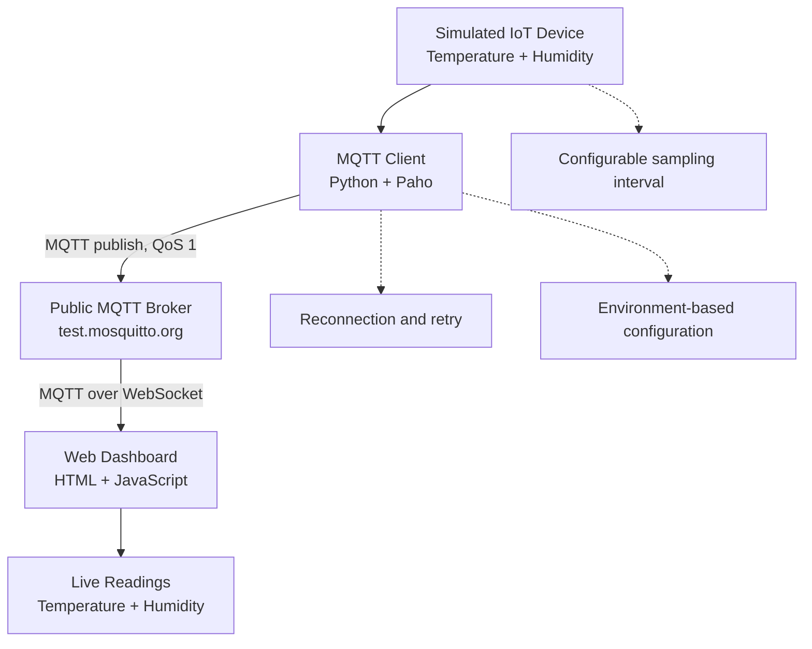

# Smart Environmental Monitor — System Architecture

## Data flow

1. The simulated device generates temperature and humidity readings.
2. The Python MQTT client publishes readings to the MQTT broker.
3. The browser dashboard subscribes to the same MQTT topic.
4. Incoming messages are displayed as live sensor readings.

## Reliability

- MQTT automatic reconnection is configured.
- The device uses QoS 1 for message delivery.
- Sampling interval is configurable.
- The dashboard attempts to reconnect when disconnected.

## Power considerations

- Sensor sampling is controlled by a configurable interval.
- A longer sampling interval can reduce device activity.
- Battery percentage is simulated for demonstration only.

## Security considerations

- No broker credentials or passwords are hardcoded.
- Broker settings can be configured using environment variables.
- The public test broker is used for demonstration, not production.
- Production deployment should use authenticated MQTT over TLS.
